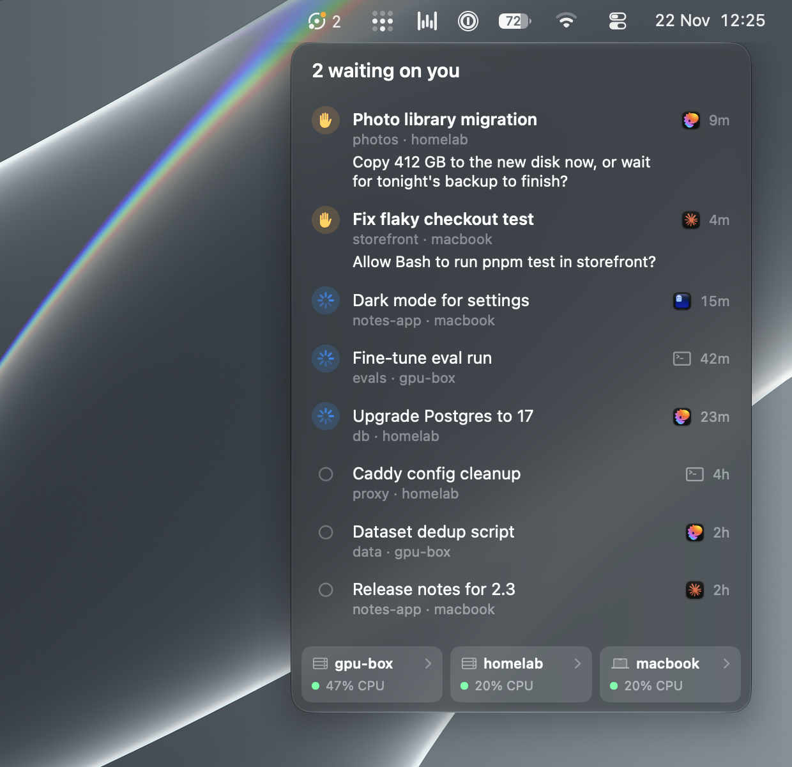
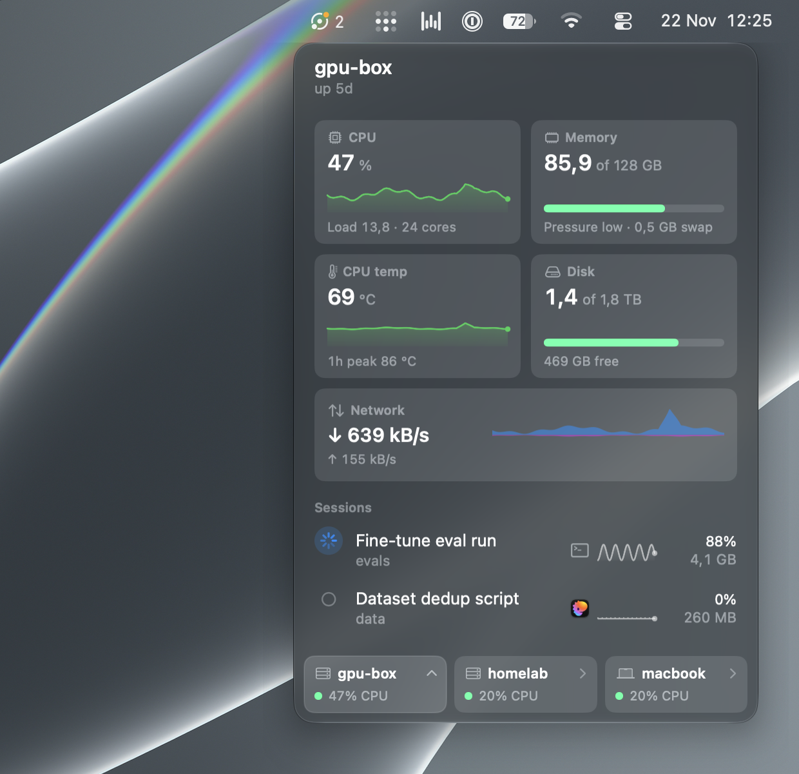

<p align="center">
  
</p>

<h1 align="center">magi</h1>

<p align="center">
  <b>Move a live Claude Code session to another machine and back, and see every session from your menu bar.</b>
</p>

<p align="center">
  
</p>

magi is a Claude Code plugin. You ask Claude, and there are no magi
commands to type. It talks to your machines only over your own SSH,
between macOS and Linux.

## The handoff

Say **"hand this off to my homelab"**. When the turn ends, the session
moves there with its conversation, its branch and your uncommitted work.
It keeps going in a tmux window on the homelab, and in the Claude app
through Remote Control. Say **"hand this back to my Mac"** and it
returns.

Claude asks first when secret files, untracked files or 50 MB or more
would go. Nothing that is running moves, and a handoff that fails leaves
the session running where it was.

You can also ask Claude to run a command or a background Claude on
another machine. It proposes a machine, waits for your yes, and brings
the changes back into your working tree.

## The menu bar app

<p align="center">
  
  
</p>

On a Mac with macOS 26 or later, magi adds a menu bar app.

- **Sessions.** It lists the sessions on all your machines, the ones
  waiting on you first. Click one to open it where it runs.
- **Notifications.** You get one when a session starts waiting on you. A
  click on it opens that session.
- **Monitor.** Click a machine for its CPU, memory, temperature and disk
  over the last hour, and what each session there uses.

The app only shows and opens sessions. It never moves or starts
anything, and never types into one.

## Install

Run these in Claude Code on your laptop.

```text
/plugin marketplace add felitrejos/magi
/plugin install magi@magi
```

Then say **"set up magi with my homelab"**. Claude says what it will
install and waits for your yes. On a Mac, setup also installs the menu
bar app.

Each machine needs `curl`, git 2.31 or newer, `tar`, tmux and Claude Code
signed in with a claude.ai account. Your laptop needs SSH to the other
machine without a password prompt.

## More

The [tutorial](docs/tutorial.md) walks through all of it in five minutes.
See also [troubleshooting](docs/troubleshooting.md),
[support](docs/support.md) and [SECURITY.md](SECURITY.md).

Licensed [MIT](LICENSE).
