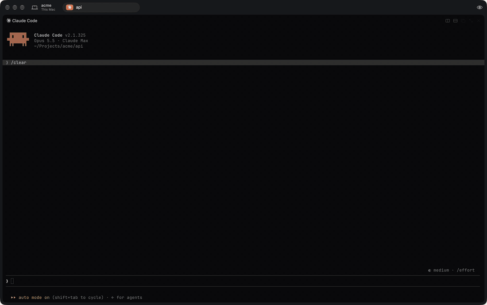

<p align="center">
  
</p>

<h1 align="center">magi</h1>

<p align="center">
  <b>See your coding agents on all your machines, and move their work to the one that fits.</b>
</p>

<p align="center">
  <a href="#magi">magi</a> ·
  <a href="#cielago">cielago</a> ·
  <a href="#how-it-works">How it works</a> ·
  <a href="#faq">FAQ</a>
</p>

<p align="center">
  
</p>

<p align="center">
  <i>CI runs on the Mac and the Linux homelab at once, and the fix made on Linux lands back on the Mac by itself.</i>
</p>

Two tools for running Claude Code and Codex across your machines:

- **cielago** does what you ask: it hands a session off to another machine,
  or lets Claude send work there. It works on its own, over SSH.
- **magi** is the overview on top, in one
  [Rex](https://www.superlogical.com/rex) pane. It shows every machine and
  session, and suggests moving a session when its machine is busy.

## magi

- **Every session, every machine.** What needs you is at the top. Below
  that, each machine has a row with its load, and its sessions are listed
  under it, one line each. No server or config file.
- **It suggests moves.** When a machine is busy and another has room, magi
  says so under the session using it. `m` moves it there through cielago.
  magi never moves anything by itself.
- **Sent work stays in view.** A session's line shows `⇢ homelab` while
  work it sent with cielago runs there. The Claude doing it shows
  `← Pre-push CI`, the session that sent it.
- **Answer from the overview.** Allow or deny a prompt, see a session's
  diff, or jump to its pane.
- **Limits and alerts.** Your 5-hour and weekly windows for Claude and
  Codex, and an alert when a session needs you, a machine goes quiet or a
  plan nearly runs out.
- **New sessions.** One opens on whichever machine has room, in a Rex
  session named after its folder. Each subagent gets a tab beside it that
  closes when it's done. Sessions run with Remote Control, so the Claude
  app can talk to them. `magi start` prints the link.
- **Light and private.** The agent idles at 0% CPU. Only devices signed in
  to your tailnet as you can connect.

```bash
curl -fsSL https://github.com/felitrejos/magi/releases/latest/download/install.sh | sh
magi agent install    # on every machine
magi                  # in a Rex pane
```

This installs magi and cielago. magi runs only in Rex, and needs
[Tailscale](https://tailscale.com) and Rex **0.1.0-preview.20** on every
machine. While Rex is in preview, magi follows only its latest release. To
see Claude Code's context use and plan windows, run `magi statusline
install`.

## cielago

In any Claude Code session, say "hand this off to my homelab". When the
turn ends, the conversation, branch, uncommitted changes and listed secrets
land there, and the session carries on in a tab of its own.

<p align="center">
  
</p>

<p align="center">
  <i>A session handed off to the homelab still remembers what it said.</i>
</p>

- **Hand off.** `cielago move <session> <host>` sends a Claude Code or
  Codex session, `cielago pull <host>` brings one back, and `cielago doctor`
  checks both ends.
- **Send work.** Claude can run a command on another machine, hand a task
  to a background Claude, or open a second session. Each runs in its own
  copy of your working tree, in a tab you can watch.
- **Claude asks first.** It picks the machine by what the work needs: one
  that runs it natively, or else a Docker or Podman container on the least
  busy one. It knows each machine's system and tools from magi, or reads
  them over SSH. Then it proposes the machine and waits for your yes.
- **Told when it's done.** Claude runs `cielago tasks wait <id>` in the
  background, so the session is woken when the work finishes. A background
  Claude's changes land in your working tree, or stay on a branch if you
  ask to review them first. `cielago tasks` lists what you've sent.
- **Built on Rex.** With Rex, sessions and tasks open as Rex tabs, the app
  switches to the new one, a background Claude shows as Claude Code, and
  ports are forwarded by Rex. Without Rex, it falls back to tmux and ssh.
  A project's `.cielago.toml` names what to start when it arrives and which
  ports to forward back, so `localhost:3000` keeps working.

```bash
curl -fsSL https://raw.githubusercontent.com/felitrejos/magi/main/install.sh | sh -s cielago
cielago init          # on each machine
claude plugin marketplace add felitrejos/magi && claude plugin install cielago@magi
```

## From scripts and other tools

magi's actions work from the command line, so a script, another
orchestrator or Claude itself can use it:

```bash
magi sessions --json            # every session on every machine
magi send fix-login "now run the tests"   # queued until it's idle
magi answer fix-login yes       # or: magi choose fix-login 2
magi move fix-login homelab
magi start homelab ~/developer/stampr/stampr
magi events                     # what needs you, as JSON lines
magi subagents                  # every running subagent and the step it's on
magi recent fix-login           # its latest steps, one line each
magi wait fix-login             # returns once it's done or needs you
```

`recent` and `wait` also take a subagent: `magi wait fix-login "find auth"`.

`magi mcp` offers the same actions as MCP tools. The ones that act
(message, answer, choose, move, start) are marked, so your client asks you
first. In Claude Code, run `claude mcp add magi -- magi mcp`. In Claude
Desktop, add this to `claude_desktop_config.json`:

```json
{ "mcpServers": { "magi": { "command": "/Users/you/.local/bin/magi", "args": ["mcp"] } } }
```

## How it works

Each machine runs `magi agent` in the background (launchd or a systemd user
service). The viewer finds the agents through Tailscale and gets a small
sample from each one every second. The agent reads the files the coding
agents already write (`~/.claude`, `~/.codex`) and follows Rex's events.
When you answer a session, it types your answer into the session's Rex pane.

| Agent on an M4 MacBook | CPU | Memory |
|---|---|---|
| Nobody watching | 0% | 6 MB |
| 32 viewers, every core busy | 0.7% | 7 MB |
| 32 viewers, 5 live Claude sessions | 2.9% | 12 MB |

## FAQ

**Can magi tell when Codex needs approval?** Yes, from Codex 0.164 on.
Codex reports its prompts to Rex the way Claude Code does, and magi follows
them.

**How do I move a Codex session?** With `cielago move`, `cielago pull` or
`m` in magi. It moves when its turn ends and reopens with `codex resume`.
If a plain `codex` is open in the same folder, quit it first, because
cielago can't tell which session it shows. The other machine needs Codex
installed, and `cielago init` asks for its path.

**Does the status line slow Claude Code down?** No. It prints first and
gives the agent at most 300 ms. It never replaces a status line you already
have.

**What if Claude Code changes its files?** They aren't a documented format.
magi notices, says so, and falls back to what the transcripts show.

What's next is in [ROADMAP.md](ROADMAP.md). What magi and cielago read, send
and change is in [SECURITY.md](SECURITY.md). Licensed [MIT](LICENSE).
