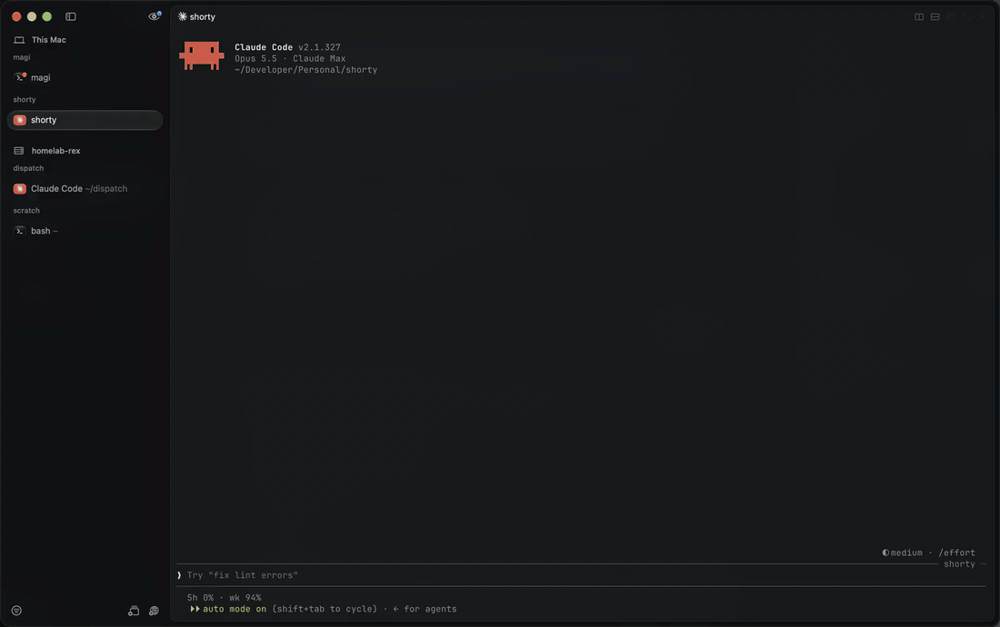

<p align="center">
  
</p>

<h1 align="center">magi</h1>

<p align="center">
  <b>Move a live Claude Code session to another machine and back, with the conversation and your uncommitted work.</b>
</p>

<p align="center">
  
</p>

You install the plugin and ask Claude. There are no magi commands to type.
magi talks to your machines only over your own SSH, between macOS and
Linux.

## Install

Run these in Claude Code on your laptop.

```text
/plugin marketplace add felitrejos/magi
/plugin install magi@magi
```

Then say "set up magi with my homelab". Claude says what it will install
and waits for your yes. Setup checks SSH to the homelab, installs the
plugin there, starts a background watcher on your laptop so sessions can
be handed back to it, and checks both machines. Then it moves a throwaway
session there and back and removes it, which takes a minute or two and
three short Claude turns on your account. If a check fails, Claude says
what to fix.

The plugin downloads the magi program that matches its version into
`~/.magi/bin` and checks its SHA-256. Each machine needs `curl`, git 2.31
or newer, `tar`, tmux and Claude Code signed in with a claude.ai account.
Your laptop needs SSH to the other machine without a password prompt.

## What you can ask

- **"Hand this off to my homelab."** magi lists what goes across, with its
  size and with secret files by name only. Claude asks you first when
  secret files, untracked files, or 50 MB or more would go. When the turn
  ends, magi copies the conversation, the branch, your uncommitted and
  untracked work, your secret files (`.env` and `.env.*` unless you list
  others) and Claude's project memory. The session continues in a tmux window on the homelab with
  Remote Control on, so it is also in the Claude app. The copy you left
  closes and refuses new messages. A handoff that fails leaves the session
  running where it was and says why.
- **"Hand this back to my Mac."** Say it in the session on the homelab,
  and the watcher on the Mac takes it back.
- **"Move session X here"** or **"move it to the server."** Claude moves
  another session between this machine and one you set up, in either
  direction. A session you quit moves too, by its full id. A session that
  is busy or waiting on you isn't moved.
- **"Does anything need me?"** Claude lists the sessions on all your
  machines and names the ones waiting on you.
- **"What did magi do?"** Claude lists moves that were cut off, recent
  handoffs, parked checkouts and forwarded ports.
- **"Let this project's setup run."** A project's `.magi.toml` can name a
  `setup` command, `services` to start beside the session and `ports` to
  forward back. Nothing in it runs until you accept its exact commands in
  a dialog Claude Code shows you. An edit to the file needs a new yes.
- **"Check my homelab"** runs setup's checks and round trip again.
  **"Uninstall magi"** removes the watcher and `~/.magi/bin` and keeps your
  config and records. You remove the plugin with `/plugin`.

Nothing that is running moves.

## Send work

<p align="center">
  
</p>

Ask Claude to run a shell command, a background Claude or a new session on
another machine. Claude proposes a machine and waits for your yes. The
work runs in its own copy of your working tree, in a tmux window you can
watch. When Claude collects a background Claude's changes, they are
applied to your working tree and kept on the branch `magi/task-<id>`. If
they clash with your edits, they stay on the branch. A background Claude
that magi started doesn't get the tools that start work, move sessions or
approve a project.

Under a host in `~/.config/magi/config.toml` you can set `max_agents`,
`min_free_memory` and `quiet_hours`, and magi starts nothing new on a
machine past them. A top-level `exclude` names untracked files and
folders that stay behind, such as `node_modules`.

## Docs

- [Tutorial](docs/tutorial.md). Five minutes from one machine to two.
- [Troubleshooting](docs/troubleshooting.md). Each message magi gives and
  what to do, such as a refused Claude Code version or a move that was cut
  off.
- [Support](docs/support.md). Which machines work, how each is tested,
  and measured times. A handoff took about 3 seconds on the owner's
  machines.
- [Versioning](docs/versioning.md) and the [changelog](CHANGELOG.md).
- [SECURITY.md](SECURITY.md) and [PRIVACY.md](PRIVACY.md). Everything
  magi runs, copies and writes. Of the files git ignores, only your secret
  files move. Logins and SSH keys never move.
- [ROADMAP.md](ROADMAP.md). What is left for 1.0.

Licensed [MIT](LICENSE).
