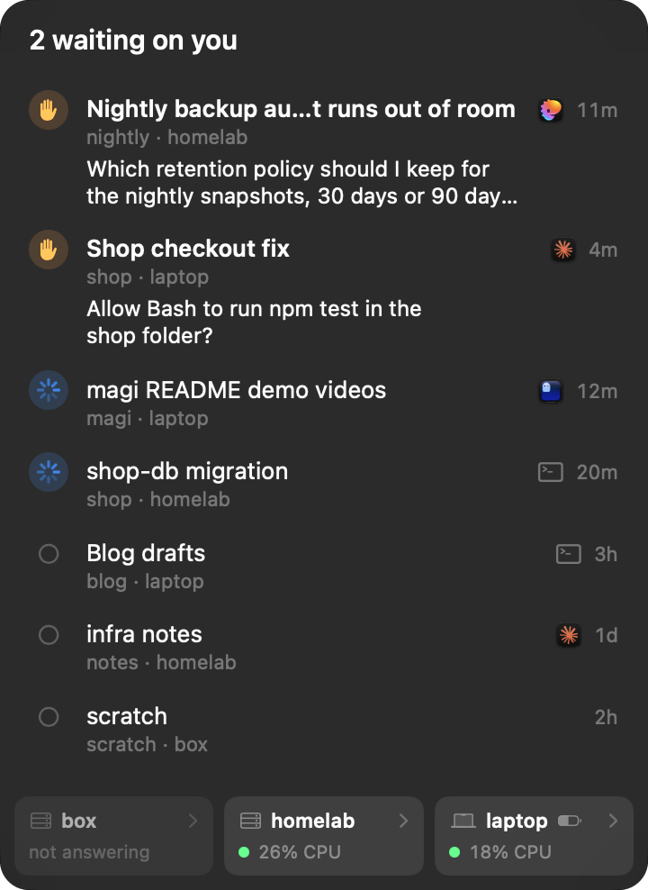
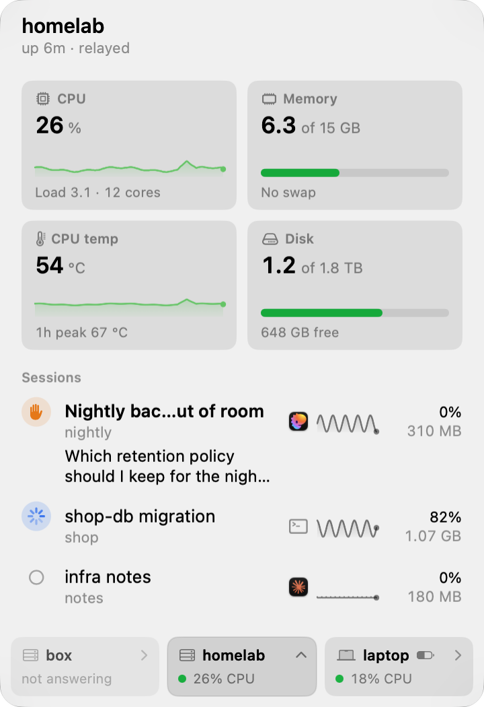
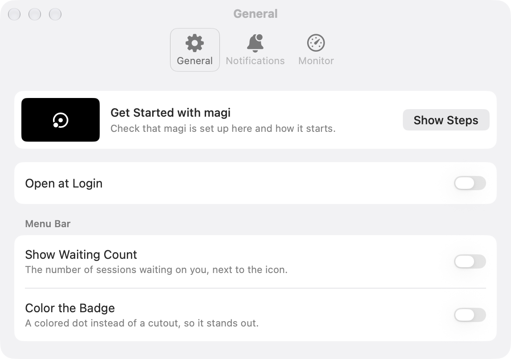

<p align="center">
  
</p>

<h1 align="center">magi</h1>

<p align="center">
  <b>Move a live Claude Code session to another machine and back, with the conversation and your uncommitted work.</b>
</p>

<p align="center">
  
</p>

You install the plugin and ask Claude. There are no magi commands to type.
magi talks to your machines only over your own SSH, between macOS and
Linux.

## Install

Run these in Claude Code on your laptop.

```text
/plugin marketplace add felitrejos/magi
/plugin install magi@magi
```

Then say "set up magi with my homelab". Claude says what it will install
and waits for your yes. On a Mac, setup also installs magi's
[menu bar app](#the-menu-bar-app). Each machine needs `curl`, git 2.31 or newer, `tar`, tmux and Claude
Code signed in with a claude.ai account. Your laptop needs SSH to the
other machine without a password prompt.

## What you can ask

- **"Hand this off to my homelab."** When the turn ends, the session
  moves with its conversation, branch, uncommitted and untracked work,
  secret files and Claude's project memory. It continues in a tmux window
  there, and in the Claude app through Remote Control. Claude asks first
  when secret files, untracked files, or 50 MB or more would go. A
  handoff that fails leaves the session running where it was.
- **"Hand this back to my Mac."** Say it in the session on the homelab.
- **"Move session X here"** or **"move it to the server."** Claude moves
  another session in either direction, unless it is busy or waiting on
  you.
- **"Does anything need me?"** Claude lists the sessions on all your
  machines and names the ones waiting on you.
- **"What did magi do?"** Claude lists moves that were cut off, recent
  handoffs, parked checkouts and forwarded ports.
- **"Let this project's setup run."** A project's `.magi.toml` can name a
  `setup` command, `services` and `ports` to forward back. Nothing in it
  runs until you accept its exact commands in a dialog.
- **"Check my homelab"** runs setup's checks again. **"Uninstall magi"**
  removes the watcher and the downloaded program. It keeps the menu bar
  app, which you remove by dragging it to the Trash.

Nothing that is running moves.

## Send work

<p align="center">
  
</p>

Ask Claude to run a shell command, a background Claude or a new session on
another machine. Claude proposes a machine and waits for your yes. The
work runs in its own copy of your working tree, in a tmux window you can
watch. A background Claude's changes come back into your working tree.

In `~/.config/magi/config.toml`, `max_agents`, `min_free_memory` and
`quiet_hours` under a host stop magi from starting new work there past
them. A top-level `exclude` names untracked files and folders that stay
behind, such as `node_modules`.

## The menu bar app

<p align="center">
  
  
</p>

On a Mac, magi has a menu bar app for macOS 26 and later. It shows the
sessions on all your machines, the ones waiting on you first.

- **Click a session** to open it where it runs: the Claude desktop app,
  Rex, Ghostty, Terminal, a tmux pane, or its Remote Control link.
- **A notification** tells you when a session starts waiting on you. A
  click on it opens that session.
- **Click a machine** for its monitor: CPU, memory, temperature and disk
  over the last hour, and what each session there uses.

The app only reads what the watcher writes. It never moves or starts
anything and never types into a session.

<p align="center">
  
</p>

Right-click the icon for Settings. General has Open at Login,
Notifications has the notification and its sound, and Monitor picks
the monitor's cards and their order.

"Set up magi" installs the app in `/Applications` and opens it, and magi
keeps it at the plugin's version. The app is signed with magi's own
certificate and isn't notarized. That works because magi installs it. A
copy downloaded with a browser is blocked by macOS, so ask Claude
instead. [SECURITY.md](SECURITY.md#the-menu-bar-app) has the details.

## Docs

- [Tutorial](docs/tutorial.md). Five minutes from one machine to two,
  and the menu bar app.
- [Troubleshooting](docs/troubleshooting.md). Each message and what to do.
- [Support](docs/support.md). Which machines work, how they are tested,
  measured times, idle cost and what a version promises.
- [SECURITY.md](SECURITY.md) and [PRIVACY.md](PRIVACY.md). Everything
  magi runs, copies and writes.
- [ROADMAP.md](ROADMAP.md) and the [changelog](CHANGELOG.md).

Licensed [MIT](LICENSE).
