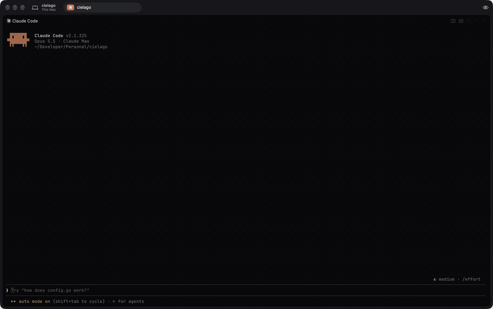

<p align="center">
  
</p>

<h1 align="center">magi</h1>

<p align="center">
  <b>Move a live Claude Code session to another machine and back, with the conversation and your uncommitted work.</b>
</p>

<p align="center">
  <a href="#moving-work-between-machines">Moving work</a> ·
  <a href="#the-overview">The overview</a> ·
  <a href="#install">Install</a> ·
  <a href="#how-it-works">How it works</a> ·
  <a href="#faq">FAQ</a>
</p>

<p align="center">
  
</p>

<p align="center">
  <i>CI runs on the Mac and the Linux homelab at once, and the fix made on Linux lands back on the Mac by itself.</i>
</p>

Claude Code can already use SSH. magi moves the session you're in.

- **It follows you.** From laptop to server and back, with its history and
  uncommitted work. Remote Control keeps it in the Claude app on your phone.
- **Work Claude sends away comes back** to your working tree by itself.
- **The overview** is the layer for [Rex](https://www.superlogical.com/rex)
  users, one pane with every machine and session.

## Moving work between machines

<p align="center">
  
</p>

<p align="center">
  <i>A session handed off to the homelab still remembers what it said.</i>
</p>

- **Hand off.** Say "hand this off to my homelab" in a Claude Code session.
  When the turn ends, the conversation, branch, uncommitted changes and
  listed secrets land there in a tab of its own. Say "hand this back to my
  Mac" there to return it, or without the overview run `magi pull MACHINE`.
  `magi move` goes either way, Codex too. `magi doctor` checks both ends.
- **Send work.** Claude can run a command on another machine, hand a task
  to a background Claude, or open a second session. Each runs in its own
  copy of your working tree, in a tab you can watch.
- **Claude asks first.** It picks the machine by what the work needs, one
  that runs it natively or else a Docker or Podman container on the least
  busy one. Then it proposes the machine and waits for your yes.
- **Work comes back.** Claude runs `magi tasks wait <id>` in the
  background, so the session is woken when the work finishes, and `magi
  tasks` lists what you've sent. A background Claude's changes land in your
  working tree, or stay on the branch `magi/task-<id>` if you ask to review
  first. If they clash with your edits, nothing is overwritten. Claude
  merges both and tells you.
- **Project setup.** A project's `.magi.toml` names what to start on arrival
  and which ports to forward back, so `localhost:3000` keeps working.
- **Rex if you have it.** Sessions and tasks open as Rex tabs, the app
  switches to the new one, a background Claude shows as Claude Code, and
  Rex forwards the ports. Without Rex, it falls back to tmux and ssh.

## The overview

- **Every session, every machine.** What needs you is at the top. Below,
  each machine has a row with its load, then its sessions, one line each.
- **It suggests moves.** When a machine is busy and another has room, magi
  says so under the session using it. `m` moves it. Nothing moves by itself.
- **Sent work stays in view.** A session's line shows `⇢ homelab` while
  work it sent runs there. The Claude doing it shows `← Pre-push CI`, the
  session that sent it.
- **Answer from the overview.** Allow or deny a prompt, see a session's
  diff, or jump to its pane.
- **Limits and alerts.** Your 5-hour and weekly windows for Claude and
  Codex, and an alert when a session needs you, a machine goes quiet or a
  plan nearly runs out.
- **New sessions.** One opens on whichever machine has room. Each subagent
  gets a tab beside it that closes when it's done. Sessions run with Remote
  Control for the Claude app, and `magi start` prints the link.
- **Better picks.** Claude also goes by each machine's live load, and
  holds back Claude work when your plan is nearly used up.
- **Light and private.** The agent idles at 0% CPU. Only devices signed in
  to your tailnet as you can connect.

## Install

```bash
curl -fsSL https://github.com/felitrejos/magi/releases/latest/download/install.sh | sh
magi init             # on each machine
claude plugin marketplace add felitrejos/magi && claude plugin install magi@magi
magi agent install    # for the overview, on every machine
magi                  # for the overview, in a Rex pane
```

This installs two programs, `magi` and `magi-remote`, and you only type
`magi`. The plugin gives Claude the handoff skill and the MCP tools. The
overview needs [Tailscale](https://tailscale.com) and Rex
**0.1.0-preview.20** on every machine, and tracks Rex's latest preview.
`magi statusline install` shows Claude Code's context use and plan windows.

## From scripts and other tools

magi's actions work from the command line, so a script, another
orchestrator or Claude itself can use it. These need the overview.

```bash
magi sessions --json            # every session on every machine
magi send fix-login "now run the tests"   # queued until it's idle
magi answer fix-login yes       # or: magi choose fix-login 2
magi move fix-login homelab
magi start homelab ~/developer/stampr/stampr
magi events                     # what needs you, as JSON lines
magi subagents                  # every running subagent and the step it's on
magi recent fix-login           # its latest steps, one line each
magi wait fix-login             # returns once it's done or needs you
magi wait fix-login "find auth" # recent and wait also take a subagent
```

`magi mcp` is one MCP server with every action. The ones that act are
marked, so your client asks you first, and the overview's tools say so when
the overview isn't running. The plugin adds the server to Claude Code. In
Claude Desktop, add this to `claude_desktop_config.json`.

```json
{ "mcpServers": { "magi": { "command": "/Users/you/.local/bin/magi", "args": ["mcp"] } } }
```

## How it works

Each machine runs `magi agent` in the background (launchd or a systemd user
service). The viewer finds the agents through Tailscale and gets a small
sample from each one every second. The agent reads the files the coding
agents already write (`~/.claude`, `~/.codex`) and follows Rex's events.
When you answer a session, it types your answer into the session's Rex pane.

| Agent on an M4 MacBook | CPU | Memory |
|---|---|---|
| Nobody watching | 0% | 6 MB |
| 32 viewers, every core busy | 0.7% | 7 MB |
| 32 viewers, 5 live Claude sessions | 2.9% | 12 MB |

## FAQ

**Can magi tell when Codex needs approval?** Yes, from Codex 0.164 on.
Codex reports its prompts to Rex the way Claude Code does, and magi follows
them.

**How do I move a Codex session?** With `magi move`, `magi pull` or `m` in
the overview. It moves when its turn ends and reopens with `codex resume`.
If a plain `codex` is open in the same folder, quit it first, because magi
can't tell which session it shows. The other machine needs Codex installed,
and `magi init` asks for its path.

**Does the status line slow Claude Code down?** No. It prints first and
gives the agent at most 300 ms. It never replaces a status line you already
have.

**What if Claude Code changes its files?** They aren't a documented format.
magi notices, says so, and falls back to what the transcripts show.

What's next is in [ROADMAP.md](ROADMAP.md). What magi reads, sends and
changes is in [SECURITY.md](SECURITY.md). Licensed [MIT](LICENSE).
