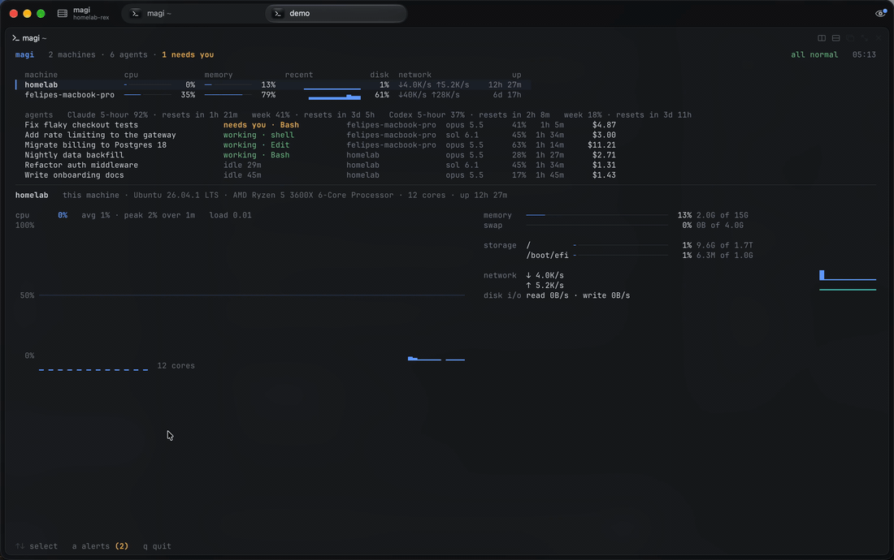

<p align="center">
  
</p>

<h1 align="center">magi</h1>

<p align="center">
  <b>Run your coding agents across all your machines, from one Rex pane.</b>
</p>

<p align="center">
  <a href="#magi">magi</a> ·
  <a href="#cielago">cielago</a> ·
  <a href="#how-it-works">How it works</a> ·
  <a href="#faq">FAQ</a>
</p>

<p align="center">
  
</p>

This repo holds two apps that work together or alone:

- **magi** watches every Claude Code and Codex session on your machines, and
  each machine's load, from one [Rex](https://www.superlogical.com/rex) pane.
  Read, answer and start sessions there.
- **cielago** moves a session, with its conversation and uncommitted work, to
  another machine, and lets Claude send work there. It needs nothing but SSH.

## magi

- **Every session, every machine.** Sessions are grouped by project, the ones
  waiting on you on top, with each machine's CPU, memory and network beside
  them. No server or config file.
- **Read, answer, start.** A session's conversation as Markdown, with its
  plan, diff and outputs a key away. Answer prompts, write to it, or start a
  new one on whichever machine has room.
- **Zen.** A second layout for watching rather than talking: a column per
  machine, its load and its sessions.
- **Limits and alerts.** Your Claude and Codex 5-hour and weekly windows, and
  an alert when a session needs you, a machine goes quiet or a plan nearly
  runs out.
- **Light and private.** The agent idles at 0% CPU, and only devices signed in
  to your tailnet as you can connect.

```bash
curl -fsSL https://github.com/felitrejos/magi/releases/latest/download/install.sh | sh
magi agent install    # on every machine
magi                  # in a Rex pane
```

This installs magi and cielago. magi needs [Tailscale](https://tailscale.com)
and Rex **0.1.0-preview.19** on every machine, and runs only in Rex. While Rex
is in preview, magi follows its latest release only. Run `magi statusline
install` where you use Claude Code to see its context use and plan windows.

## cielago

<p align="center">
  
</p>

- **Move a session.** Press `m` in magi, or tell Claude "hand this off to my
  homelab". When the turn ends, the conversation, branch, uncommitted changes
  and listed secrets land on the other machine, and the session continues
  there. `cielago pull <host>` brings it back.
- **Send work.** Claude gets tools to run a command elsewhere, hand a task to
  a background Claude, or open a second session, each in a copy of your
  working tree on the lightest machine. Claude asks you first.
- **Ports follow.** A project's `.cielago.toml` names what to start when it
  arrives and which ports to forward back, so `localhost:3000` keeps working.

```bash
curl -fsSL https://github.com/felitrejos/magi/releases/latest/download/install.sh | sh -s cielago
cielago init          # on each machine
claude plugin marketplace add felitrejos/magi && claude plugin install cielago@magi
```

cielago runs sessions in Rex when it's there and in tmux otherwise.
`cielago doctor` checks both ends.

## How it works

Each machine runs `magi agent` in the background (launchd or a systemd user
service). The viewer finds agents through Tailscale and gets a compact sample
from each every second. The agent reads what the coding agents already write
(`~/.claude`, `~/.codex`) and follows Rex's events for each pane's state. When
you answer a session, the agent on that machine types it into the session's
Rex pane.

| Agent on an M4 MacBook | CPU | Memory |
|---|---|---|
| Nobody watching | 0% | 6 MB |
| 32 viewers, every core busy | 0.7% | 7 MB |
| 32 viewers, 5 live Claude sessions | 2.9% | 12 MB |

## FAQ

**Can magi tell when Codex needs approval?** Not yet. Codex doesn't write its
approval prompts to disk, so answer those in its pane.

**Does the status line slow Claude Code down?** No. It prints first, gives the
agent at most 300 ms, and never replaces a status line you already have.

**What if Claude Code changes its files?** They aren't a documented format.
magi notices, says so, and falls back to what the transcripts show.

What's next is in [ROADMAP.md](ROADMAP.md). What magi and cielago read, send
and change is in [SECURITY.md](SECURITY.md). Licensed [MIT](LICENSE).
