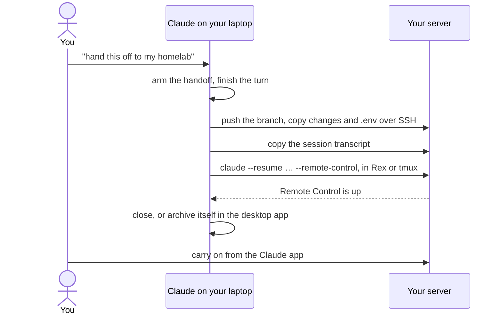

<p align="center">
  
</p>

<h1 align="center">cielago</h1>

<p align="center">
  <b>Your session, on another machine, in seconds.</b><br>
  Tell Claude Code "hand this off to my homelab" and the conversation keeps going there, with your branch, your changes and your <code>.env</code>.
</p>

<p align="center">
  <a href="#install"><b>Install</b></a> ·
  <a href="#how-it-works">How it works</a> ·
  <a href="#configure">Configure</a> ·
  <a href="#questions">Questions</a> ·
  <a href="docs/research/report.md">Research</a>
</p>

<p align="center">
  
  
  
  <a href="LICENSE"></a>
</p>

<p align="center">
  
</p>
<p align="center">
  <i>A real handoff from a MacBook to a home server, recorded with <a href="https://github.com/charmbracelet/vhs">VHS</a> (<a href="assets/handoff.tape">source</a>).</i>
</p>

You start something on your laptop, and then you want it running on the
always-on machine in the closet: so it keeps going when the lid closes, so it
can use the bigger CPU, so you can check on it from your phone. Until now that
meant starting over and explaining everything again.

cielago moves the session itself. Ask for it in plain words and, as soon as the
current turn ends, your branch, your uncommitted work, your secret files and the
whole conversation land on the other machine. Claude picks up exactly where it
was, with Remote Control on, and the copy on your laptop closes.

## What you get

1. **Seconds, not a fresh start.** A handoff over Tailscale on a home network
   takes about three seconds once the turn ends, and most of that is Claude
   starting up on the other side.
2. **The whole conversation.** The session is resumed from its own transcript,
   not a summary, so everything Claude knew on your laptop it still knows.
3. **Your working tree comes along.** Commits, the current branch, edited, new
   and deleted files, all matched to the same repository on the other machine
   even when it lives at a different path.
4. **Your secrets too.** `.env` files and anything else you list travel over
   SSH, straight from disk to disk, never through the conversation.
5. **Pick it up anywhere.** The session starts with Remote Control, so you
   continue from the Claude app, your phone or claude.ai, and it opens in a
   [Rex](https://superlogical.com) pane or a tmux window you can attach to.
6. **Nothing in the middle.** Plain SSH between your own machines. No relay, no
   extra account, no daemon.
7. **One place at a time.** It refuses to clobber work on the other machine,
   leaves the session running where it was if anything fails, and retires the
   old copy so the same session never runs twice.

```text
inspect 0.3s · sync 0.2s · transcript 0.1s · launch 0.0s · start 2.4s   →   3.0s
```
<p align="center"><i>A typical handoff, as cielago reports it.</i></p>

## How it works



The `handoff` skill tells the agent to run `cielago arm`, then end its turn.
When the turn is over, the plugin's Stop hook does the move:

- finds the same repository on the server by its `origin` remote;
- checks Claude Code already trusts that folder there;
- pushes your commits and checks out your branch, and stops if the server has
  uncommitted work or commits you don't have;
- copies changed, new and deleted files, plus files matching `secrets`;
- copies the transcript into the server's `~/.claude/projects`;
- starts the session beside the repository's Rex window, or in a tmux window,
  with a first message telling Claude where it is now;
- waits for Remote Control, then closes the laptop's copy and renames its
  transcript so it can't be resumed twice.

## Install

```bash
go install github.com/felitrejos/cielago@latest
claude plugin marketplace add felitrejos/cielago
claude plugin install cielago@cielago
```

On the server, cielago needs `git`, `tar`, and Claude Code logged in with
`claude auth login`. Remote Control doesn't work with `setup-token` tokens.

## Getting started

1. Make sure `ssh <server>` works with a key, no password prompt.
2. Write `~/.config/cielago/config.toml` (see below).
3. On the server, open each project once with `claude` and accept the trust
   prompt.
4. In any Claude Code session, say **"hand this off to my homelab"**.

## Configure

`~/.config/cielago/config.toml`, one table per machine:

```toml
[hosts.homelab]
ssh = "homelab"                            # ssh destination
claude = "~/.local/bin/claude"             # claude binary on the server
roots = ["~/developer"]                    # where your clones live, up to two folders deep
secrets = [".env", ".env.*", ".dev.vars"]  # gitignored files to bring along
launcher = "rex"                           # "rex" or "tmux"
rex_server = "homelab"                     # rex: opens beside the window named after the repo
# tmux_session = "cielago"                 # tmux: session to open a window in
```

The name of the table is what you call the machine: "hand this off to my
homelab" finds `[hosts.homelab]`.

## Questions

**Does it work from the Claude desktop app?**
Yes. A session in the app tells you where it went and archives itself, so only
the new one is left. The app asks you to approve the archive with one click.

**What happens to dev servers and background tasks?**
They stay behind. The conversation and the files move; processes start fresh
on the server when you need them.

**Can I hand it back to the laptop?**
Not yet. That needs the server to reach your laptop over SSH, which most home
setups don't allow.

**What if something goes wrong halfway?**
The session keeps running on your laptop and Claude tells you what failed. If
it got as far as changing the server's checkout, the message says so.

**Where do my secrets go?**
From your laptop's disk to the server's, over SSH. They never enter the
conversation, the transcript or cielago's output. The laptop's copy replaces
the server's, so values that only exist in the server's `.env` are overwritten.

**Do I need Rex?**
No. Set `launcher = "tmux"` and the session opens in a tmux window on the
server. Remote Control works the same either way.

**Does this use A2A or some other agent protocol?**
No. Those delegate tasks between different agents; cielago moves one agent's
own session. The [research notes](docs/research/report.md) cover why.

## Limits

- It moves between turns, never in the middle of a reply or a tool call.
- Staged and unstaged changes both arrive unstaged.
- Claude's per-project memory folder stays separate on each machine.
- `node_modules` and other build output aren't copied; reinstall if a lockfile
  changed.

## Contributing

```bash
go test ./...
```

The tests run cielago's generated server-side scripts against a fake SSH host,
including branch names built to break out of the shell. To re-record the demo,
run `vhs assets/handoff.tape` with a `demo-app` clone on both machines.

## License

[MIT](LICENSE)
